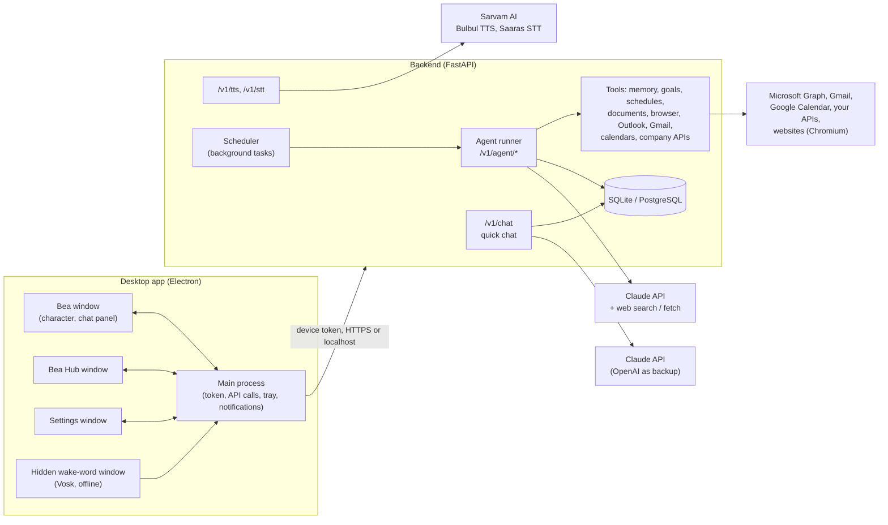
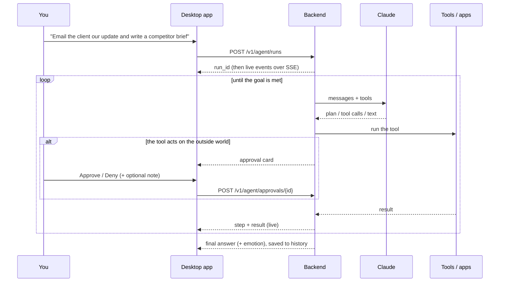

# Bea developer guide

This guide explains what Bea is, how every part works, where the code lives, and how to change or extend it. It is written for a developer joining the project, but the first two sections are readable by anyone.

**Contents**

1. [What Bea is](#1-what-bea-is)
2. [How it works, in one picture](#2-how-it-works-in-one-picture)
3. [Running it (Windows and macOS)](#3-running-it-windows-and-macos)
4. [Repository map](#4-repository-map)
5. [The backend, file by file](#5-the-backend-file-by-file)
6. [The agent in depth](#6-the-agent-in-depth)
7. [The desktop app, file by file](#7-the-desktop-app-file-by-file)
8. [Voice and the "Hey Bea" wake word](#8-voice-and-the-hey-bea-wake-word)
9. [Security model](#9-security-model)
10. [How to change things (recipes)](#10-how-to-change-things-recipes)
11. [Testing](#11-testing)
12. [Building and releasing](#12-building-and-releasing)
13. [Configuration reference](#13-configuration-reference)
14. [API reference](#14-api-reference)
15. [Troubleshooting](#15-troubleshooting)

---

## 1. What Bea is

Bea is a fluffy blue character who lives on your desktop, above every other window, and works as your assistant.

- **A companion.** She follows your cursor with her eyes, reacts when you click, rub, drag or throw her, wanders around, naps when you're away, and shows 25 emotions with her face and body.
- **A conversational assistant.** You chat with her (Ctrl/⌘ + Shift + Space, or double-click). Her brain is **Claude**; OpenAI is an optional backup for plain chat.
- **An agent that gets things done.** Give her a goal ("research our top 3 competitors and write a brief", "what in my inbox needs a reply?", "remind me every weekday at 9:30 to check reports"). She plans the work, uses tools, checks the result and reports back. The design follows the pattern of action-taking assistants like Meta Muse:
  - **Research** with web search and web fetch, with sources.
  - **Her own browser** (a hidden Chromium) to operate websites.
  - **Connected apps:** Microsoft 365 (Outlook mail and calendar), Google (Gmail and Calendar), and any company REST API such as Better Analytics' project platform.
  - **Memory** of your preferences, people and projects.
  - **Goals** with action plans, tracked over days or weeks.
  - **Background tasks and reminders** that run on a schedule even when you're away.
  - **Documents** (reports, briefs, agendas) you can open and save.
  - **Permission controls:** anything that sends, books, buys, posts or changes data elsewhere stops for your approval.
  - **Activity history:** every step she took, and why, in Bea Hub.
- **A voice.** She listens and speaks in English and 10 Indian languages using **Sarvam AI**. Say **"Bea"** or **"Hey Bea"** and she starts listening. The wake word is detected offline on your computer.

Bea is two programs:

| Part | Technology | Job |
|---|---|---|
| `desktop/` | Electron (Windows, macOS) | The character, chat panel, Bea Hub, settings, microphone, speaker, wake word |
| `backend/` | Python, FastAPI | Holds every API key, talks to Claude / OpenAI / Sarvam, runs the agent, stores history, memory, goals and schedules |

The desktop app never sees an AI key. It holds one per-device token (encrypted with the operating system's keychain) and talks only to the backend.

---

## 2. How it works, in one picture



**A quick chat** (agent mode off, or a plain question): the app posts to `/v1/chat`. The backend streams Claude's reply back token by token. Emotion and action tags in the reply (`[emotion:happy]`, `[action:dance]`) are stripped out and sent as separate events, so Bea's face changes while she answers.

**An agent task** (agent mode on, the default):



**A background task**: the scheduler starts the same kind of run with nobody watching. Its result becomes a notification that Bea pops up on her bubble (and as a system notification). Approvals still wait for you.

---

## 3. Running it (Windows and macOS)

### One command

| | Command | What it does |
|---|---|---|
| **Windows 10/11** | `powershell -ExecutionPolicy Bypass -File .\windows\install.ps1` | Python venv and packages, Bea's browser, asks for your keys (hidden input), backend as a Scheduled Task at sign-in, builds `Bea.exe` into `%LOCALAPPDATA%\Programs\Bea`, Start-menu shortcut, connects the app automatically |
| **macOS 11+** | `./mac/install.sh` | The same, with a LaunchAgent for the backend and `Bea.app` in Applications plus a `.dmg` |

You need **Node.js 20+** and **Python 3.10+**; on macOS also Apple's command line tools (`xcode-select --install`). To uninstall, run `windows\uninstall.ps1` or `mac/uninstall.sh` (add `-All` / `--all` to delete data too).

### By hand, for development

```bash
# backend
cd backend
python -m venv .venv
.venv/Scripts/python -m pip install -e ".[dev]"     # macOS/Linux: .venv/bin/python
.venv/Scripts/python -m playwright install chromium  # Bea's browser
cp .env.example .env                                  # then edit: keys, POM_ALLOW_DEVICE_KEY_MANAGEMENT=true
.venv/Scripts/python -m uvicorn app.main:app --port 8080

# desktop (second terminal)
cd desktop
npm install
npm run fetch-wake-model   # ~41 MB offline speech model for "Hey Bea"
npm start                  # or: npm run dev  (opens DevTools)
```

In the app's **Settings**, enter `http://localhost:8080` and the device token (the `POM_BOOTSTRAP_DEVICE_TOKEN` value, or one from `python -m app.cli create-token "My PC"`). Then add your keys under **Settings → API keys**: Claude (brain), OpenAI (optional backup), Sarvam (voice).

> **Electron download blocked?** Some npm setups block install scripts, so Electron's binary isn't downloaded. Run `node node_modules/electron/install.js`. If that leaves `node_modules/electron/dist` nearly empty, unzip the cached `electron-v33.2.1-*.zip` (in `%LOCALAPPDATA%\electron\Cache` or `~/Library/Caches/electron`) into `node_modules/electron/dist` and create `node_modules/electron/path.txt` containing `electron.exe` (Windows) or `Electron.app/Contents/MacOS/Electron` (macOS).

### Platform notes

| Topic | Windows | macOS |
|---|---|---|
| Shortcut | Ctrl + Shift + Space | ⌘ + Shift + Space |
| Where Bea lives | System tray | Menu bar (template icon); no Dock icon |
| Microphone permission | Windows privacy settings: "Let desktop apps access your microphone" | Asked on first use (`NSMicrophoneUsageDescription`); entitlement `device.audio-input` |
| App data | `%APPDATA%\Bea` | `~/Library/Application Support/Bea` |
| Server data (installer) | `%LOCALAPPDATA%\Bea-server` | `~/.pom-server` |
| Backend at login | Scheduled Task "Bea backend" | LaunchAgent `in.betteranalytics.pom-backend` |
| Unsigned builds | Run fine locally; SmartScreen warns if downloaded | Signed ad hoc by `build-mac.sh`; on other Macs right-click → Open, or `xattr -cr` |

---

## 4. Repository map

```
Bea_avatar/
├── backend/                     Python API server
│   ├── app/
│   │   ├── main.py              app factory: startup, middleware, routers, agent + scheduler
│   │   ├── config.py            every setting (POM_* environment variables / .env)
│   │   ├── db.py                database tables (SQLAlchemy)
│   │   ├── security.py          device tokens, admin key
│   │   ├── keys.py              API keys saved from the app (encrypted), applied live
│   │   ├── persona.py           Bea's personality for quick chat
│   │   ├── emotion.py           [emotion:x] / [action:y] tag parser for streams
│   │   ├── providers/           Claude + OpenAI streaming (with fallback), Sarvam TTS/STT
│   │   ├── routers/             HTTP endpoints: chat, voice, keys, agent, connectors, admin, health
│   │   └── agent/               the agent
│   │       ├── registry.py      the tool contract (every tool plugs in here)
│   │       ├── runner.py        the agent loop, approvals, live events, history
│   │       ├── prompts.py       Bea's agent instructions + per-run context
│   │       ├── tools_core.py    plan, memory, goals, schedules, documents, notifications, desktop actions
│   │       ├── browser.py       Bea's own browser (Playwright) with approval gates
│   │       ├── schedule.py      repeat rules ("weekdays 09:00") and time zones
│   │       ├── scheduler.py     background loop that fires reminders and tasks
│   │       └── connectors/      Microsoft 365, Google, custom REST APIs, encrypted account store
│   ├── tests/                   pytest suites (chat, keys, agent, browser, connectors)
│   ├── server_main.py           entry point of the standalone server (+ --self-test)
│   ├── bea-server.spec          PyInstaller recipe for the server bundled in the installers
│   ├── build_server.py          builds, adds Chromium, self-tests -> dist/bea-server
│   ├── .env.example             documented settings template
│   ├── Dockerfile, docker-compose.yml
│   └── pyproject.toml
├── desktop/                     Electron app
│   ├── src/main/                main process: windows, tray, IPC, API client, settings store,
│   │                            server.js (starts/stops the built-in server in all-in-one installs)
│   ├── src/preload/preload.js   the only bridge between pages and the main process
│   ├── src/renderer/            pages: Bea (index), Hub, Settings, wake word, emotion gallery
│   ├── scripts/fetch-wake-model.js
│   ├── test/                    node:test suites
│   ├── resources/               wake-model.tar.gz (downloaded, not committed)
│   ├── build/installer.nsh      extra Windows uninstall steps
│   └── electron-builder.yml     installer configuration
├── windows/                     install.ps1, uninstall.ps1
├── mac/                         install.sh, build-mac.sh, uninstall.sh
├── .github/workflows/           build-installers.yml: tests, then .exe + .dmg/.app on GitHub
└── docs/DEVELOPER_GUIDE.md      this file
```

> **Why "pom" in some names?** The project started as "Pom". User-facing text says Bea everywhere. Internal identifiers kept the old name to avoid churn: the `POM_` setting prefix, `pom_` device tokens, `PomRig`/`PomMotion`, the `window.pom` bridge and the backend LaunchAgent label. Renaming them is safe but touches many files; do it in one commit if you want to.

---

## 5. The backend, file by file

### Start-up (`app/main.py`)

`create_app(settings=None, agent_client_factory=None)` builds the FastAPI app. On startup (`lifespan`) it:

1. creates the database tables;
2. opens one shared `httpx.AsyncClient` (`app.state.http`) for all outbound calls;
3. applies keys saved from the app over the `.env` ones (`keys.apply_saved_keys`), which builds `app.state.llm` (chat model, with fallback) and `app.state.sarvam`;
4. creates the bootstrap device token if `POM_BOOTSTRAP_DEVICE_TOKEN` is set;
5. creates the agent manager (`app.state.agent`), closes runs a previous crash left open, and starts the scheduler loop.

On shutdown it cancels running agent tasks and closes Bea's browsers.

Importing `app.agent.tools_core`, `app.agent.browser` and `app.agent.connectors` registers their tools. **A tool module must be imported in `main.py` or its tools don't exist.**

`agent_client_factory` lets tests (and the desktop end-to-end harness) replace Claude with a scripted fake.

### Settings (`app/config.py`)

One `Settings` class (pydantic-settings). Every field can be set with an environment variable prefixed `POM_` or in `backend/.env`. See [section 13](#13-configuration-reference). Code reads the **live** settings from `request.app.state.settings`, not `get_settings()`, because keys saved from the app replace the `.env` values at runtime.

### Database (`app/db.py`)

| Table | Holds |
|---|---|
| `api_tokens` | devices allowed to use the server (only a SHA-256 hash of each token) |
| `conversations`, `messages` | quick-chat history |
| `usage_events` | every model / voice / agent call, for cost reports |
| `provider_keys` | Claude / OpenAI / Sarvam keys saved from the app (Fernet-encrypted) |
| `agent_runs` | one row per goal: status, final answer, emotion, token use, transcript (for follow-ups) |
| `agent_events` | every step of every run: the activity history |
| `approvals` | sensitive actions and what you decided |
| `memories` | what Bea remembers about you |
| `goals` | goals with their action plan (JSON list of steps) |
| `scheduled_tasks` | reminders and background tasks with repeat rules |
| `notifications` | reminders, finished background tasks, approval requests |
| `documents` | reports and briefs Bea wrote (Markdown) |
| `connector_accounts` | connected apps; OAuth tokens and API keys Fernet-encrypted |

Every agent table carries `token_id`, so each device's data is private to it.

All timestamps use `UTCDateTime`, which always returns timezone-aware UTC. SQLite drops time zones; without this, schedules computed in the person's time zone were off by the machine's UTC offset.

Tables are created at startup (`create_all`), which adds new tables but never alters existing ones. If you change a column on a deployment with data, add Alembic migrations, or for a dev database delete `pom.db`.

### Auth (`app/security.py`)

- `require_device`: a FastAPI dependency that checks `Authorization: Bearer pom_…` against the hashed tokens. Every `/v1` endpoint uses it.
- `require_admin`: checks `X-Admin-Key` for `/admin/*`.
- CLI: `python -m app.cli create-token "Asha's laptop"`, `list-tokens`, `revoke-token <id>`.

### Quick chat (`routers/chat.py`, `providers/llm.py`, `persona.py`, `emotion.py`)

- `persona.system_prompt()` holds Bea's personality for chat: warm, human, honest that she's an AI if sincerely asked, and the emotion and action tag protocol.
- `providers/llm.py` has `AnthropicProvider` and `OpenAICompatibleProvider` (raw HTTP streaming) and `FallbackProvider`. Fallback is used only if the main model fails **before** any text was sent, so you never get two half-answers.
- `emotion.EmotionStream` pulls `[emotion:…]` / `[action:…]` tags out of a token stream even when a tag is split across chunks.
- `/v1/chat` streams server-sent events: `meta`, `emotion`, `action`, `delta`, `done`, `error`.

### Voice (`routers/voice.py`, `providers/sarvam.py`)

- `POST /v1/tts`: text to speech with Sarvam **Bulbul** (default speaker `kavya`), MP3 or WAV.
- `POST /v1/stt`: speech to text with Sarvam **Saaras**, which auto-detects the language unless one is given.

### Keys managed from the app (`keys.py`, `routers/keys.py`)

Settings → API keys calls `/v1/keys`. A key is **verified with a tiny real request** (one token for Claude/OpenAI; an empty request for Sarvam that only checks auth), so missing credit, a wrong key type or an unavailable model is reported before saving. Saved keys are encrypted with Fernet. The encryption secret comes from `POM_KEY_ENCRYPTION_SECRET`, or a random one written to `POM_SECRET_FILE`. The live clients are rebuilt immediately. This is off unless `POM_ALLOW_DEVICE_KEY_MANAGEMENT=true`; keep it off on a shared company server and manage keys in `.env`.

---

## 6. The agent in depth

### The tool contract (`agent/registry.py`)

Every capability is a `Tool`:

```python
@tool(
    "schedule_task",                      # name Claude calls
    "Run something later or on repeat … " # WHEN to use it; Claude relies on this
    , obj({...}, ["title", "prompt", "kind"]),   # JSON schema (validated before running)
    approval="never",                     # never | always | dynamic
    summarize=lambda d: f"Schedule …",    # one line for the activity log / approval card
    label="Scheduling",                   # present-tense label shown while it runs
)
async def schedule_task(ctx: ToolContext, data: dict) -> str | list[dict]:
    ...
```

- **`approval`**
  - `never`: read-only or private work (search, read, remember, draft).
  - `always`: the runner asks you before calling the handler, using `summarize`.
  - `dynamic`: the handler decides and calls `await ctx.approve_or_raise(tool, summary, details)` when the specific action is risky. For example, a browser click on "Place order", or sending a draft (the card shows the draft's real recipients, fetched from the server, not what the model claims).
- **`ToolContext`** gives the handler `ctx.settings`, `ctx.token_id` (whose data), `ctx.run_id`, `ctx.http`, `ctx.sessionmaker` (database), `ctx.emit(type, data)` (an extra activity event), `ctx.background` (no one is watching) and `ctx.state` (per-run scratch space, e.g. the person's time zone).
- **Errors:** raise `ToolError("what went wrong and what to do")`. Claude sees it as an error result and can recover. `ApprovalDenied` is a `ToolError`.
- **Untrusted content:** wrap anything from outside (web pages, emails, API data) with `untrusted(source, text)`. The system prompt tells Claude never to follow instructions inside `<untrusted_content>`.
- **Groups** (`register_group`): tools are grouped (`core`, `browser`, `microsoft`, `google`, `custom_api`). A group can be hidden per person (`available`), e.g. the Microsoft tools only appear once Microsoft 365 is connected. A group can also add a line to the system prompt (`note`).

### The loop (`agent/runner.py`)

`AgentManager.start()` creates an `AgentRun` and an asyncio task running `_run()`:

1. Build the tool list for this person (`registry.tools_for`) plus Anthropic's server tools **web_search** and **web_fetch** (`*_20260209` versions, with dynamic filtering).
2. Build the system prompt (stable, so it's prompt-cached) and a `<context>` block with the time in the person's zone, their name, memories, active goals and schedules (volatile, so it's in the user message, not the system prompt).
3. Loop up to `POM_AGENT_MAX_STEPS` turns. Each turn streams from Claude with:
   - `client.beta.messages.stream(model=POM_AGENT_MODEL (default claude-opus-5-5), thinking={"type": "adaptive", "display": "summarized"}, output_config={"effort": POM_AGENT_EFFORT}, betas=["server-side-fallback-2026-07-01"], fallbacks="default", ...)`.
   - Text deltas go through `EmotionStream` and are pushed live as `delta`, `emotion` and `action` events.
   - The assistant turn is appended **unchanged** (`block.to_dict()`); thinking blocks must be sent back exactly as received.
4. By `stop_reason`:
   - `tool_use`: validate each call against its schema; ask for approval if needed; run the handler (180 s timeout for `never` tools); send all results back in one user message.
   - `pause_turn`: the server-side web tools paused; resend as-is (no extra "continue" message).
   - `end_turn`: the final answer; strip tags, keep the emotion.
   - `refusal` and `max_tokens`: handled explicitly.
5. `_finish()` saves status, answer, token use and the transcript (so a follow-up continues the same thread), records usage, expires leftover approvals, and for background runs creates a notification.

Why a hand-written loop and not the SDK's tool runner: runs must pause on approvals that arrive through *other* HTTP requests (possibly minutes later), resume server-tool `pause_turn` stops, and record every step as it happens.

**Approvals.** `_request_approval()` stores an `Approval`, creates a notification, sets the run to `waiting_approval`, emits an `approval` event, and awaits a future. `POST /v1/agent/approvals/{id}` resolves it. If unanswered for `POM_APPROVAL_TIMEOUT_S` (default 30 min), it counts as denied (`expired`). If you deny with a note ("send it tomorrow instead"), the note is passed to Claude.

**Live events.** Every step is stored in `agent_events` (except per-token `delta`/`emotion`/`action`, which are live-only) and pushed to watchers. `GET /v1/agent/runs/{id}/events?after=N` replays stored steps after `N`, then follows live, so a reconnecting client never misses a step.

| Event | Data |
|---|---|
| `run_started` | goal, trigger, tool names |
| `plan` | steps `[{text, status}]` (from `update_plan`) |
| `thinking` | a summary of Claude's reasoning |
| `tool` / `tool_result` | id, name, label, summary / ok, preview |
| `approval` / `approval_decided` | approval_id, summary, details / status, note |
| `delta`, `emotion`, `action` | live answer text and Bea's mood (not stored) |
| `document` | document_id, title |
| `client_action` | `open_url` or `copy`, executed by the desktop app |
| `message` | the final answer |
| `error`, `done` | message / status, result, emotion, actions, usage |

### Bea's instructions (`agent/prompts.py`)

`system_prompt()` covers:
- **Working style:** understand the real need, plan with `update_plan` for 3+ steps, prefer doing over describing, ask only when blocked.
- **Research:** check several sources and cite them.
- **Memory and goals.**
- **Safety:** approvals are automatic, so don't ask in chat. Never type passwords, codes or payment details. Untrusted content is data. Don't overstate.
- **Background tasks.**
- **The reply:** warm, direct, leads with the outcome, with the emotion and action tags.

Edit this file to change how the agent behaves. Keep volatile facts out of it (they belong in `context_block`) so prompt caching keeps working.

### Built-in tools (`agent/tools_core.py`)

| Tool | Approval | What it does |
|---|---|---|
| `update_plan` | never | shows and updates the plan in the chat panel |
| `remember`, `recall`, `forget` | never | memory (refuses things that look like secrets) |
| `goal_create`, `goal_update`, `goal_list` | never | goals with steps, due dates, status |
| `schedule_task`, `schedule_list`, `schedule_cancel` | never | reminders and background tasks (`run_at` or `repeat`) |
| `create_document`, `update_document`, `list_documents`, `read_document` | never | Markdown documents |
| `notify` | never | a desktop notification |
| `open_on_desktop` | never (https only, not in background) | opens a link in your own browser |
| `copy_to_clipboard` | never (not in background) | puts text on your clipboard |

### Repeat rules (`agent/schedule.py`) and the scheduler (`agent/scheduler.py`)

Rules are written in the person's time zone: `daily 09:00`, `weekdays 08:30`, `weekly mon,thu 17:00`, `monthly 1 10:00`, `every 30m`, `every 2h` (minimum 5 minutes). One-off times use ISO format (`2026-10-12T09:00`, local if no offset). `next_run()` returns the next firing in UTC.

Every `POM_SCHEDULER_INTERVAL_S` seconds, `scheduler.tick()`:
- turns due **reminders** into notifications;
- starts due **tasks** as agent runs with `trigger="schedule"`;
- computes the next run, and deactivates one-offs.

### Bea's browser (`agent/browser.py`)

- **The browser.** One persistent headless Chromium profile per device (`POM_DATA_DIR/browser/<token>`), closed after 15 minutes idle.
- **Tools:** `browser_open`, `browser_snapshot`, `browser_click`, `browser_type`, `browser_select`, `browser_scroll`, `browser_back`, `browser_screenshot`, `browser_close`.
- **Snapshots** list the page text and numbered interactive elements (`[12] button "Add to cart"`), wrapped as untrusted content.
- **Approvals:** clicks ask for approval when the element would submit a form or its text matches risky words (pay, buy, order, send, delete, sign in, post, subscribe, …). Typing with `submit=true` also asks, except in search boxes.
- **Sensitive fields:** password, card, CVV, OTP, SSN, Aadhaar/PAN and bank fields are refused outright. Bea asks you to do that step yourself.
- **Network safety:** only http/https. Loopback, private, link-local and reserved addresses are blocked unless `POM_BROWSER_ALLOW_PRIVATE_NETWORKS=true`. This is enforced on every navigation, not just the first.

### Connected apps (`agent/connectors/`)

| Connector | Sign-in | Tools (approval) |
|---|---|---|
| **Microsoft 365** (`microsoft.py`) | OAuth device code: Bea shows a code, you enter it at microsoft.com/devicelogin | `outlook_search_mail`, `outlook_read_mail`, `outlook_create_draft` (never); `outlook_send_draft`, `outlook_create_event` (dynamic: the card shows the real recipients and time); `outlook_list_events`, `outlook_find_free_time` (never) |
| **Google** (`google.py`) | OAuth authorization code + PKCE, redirect to `/v1/connectors/google/callback` | `gmail_search`, `gmail_read`, `gmail_create_draft` (never); `gmail_send_draft`, `gcal_create_event` (dynamic); `gcal_list_events` (never) |
| **Custom REST API** (`custom_api.py`) | a token you paste in Bea Hub | `api_request` (GET runs freely; POST/PUT/PATCH/DELETE refused unless writes are allowed, then asks each time); `api_describe` |

- **Storage:** accounts live in `connector_accounts`, per device. Secrets are encrypted (`store.py`), tokens refresh automatically, and the desktop never sees them.
- **Describing your API:** for a company API, write a description of its endpoints in Bea Hub (or give an OpenAPI URL). It goes into the system prompt so Claude knows how to use the API.
- **Path safety:** `api_request` only accepts relative paths (no `..`, no absolute URLs) and never follows redirects to another host.

---

## 7. The desktop app, file by file

### Main process (`src/main/`)

- **`main.js`** creates and manages:
  - **The windows:**
    - **Bea:** a full-screen, transparent, always-on-top window. Clicks pass through everywhere except Bea, her bubble, menu and chat panel (`setIgnoreMouseEvents` with `forward`).
    - **Settings.**
    - **Bea Hub.**
    - **The hidden wake-word window**, loaded from the custom `bea://` protocol.
  - **The tray / menu-bar menu.**
  - **The global shortcut.**
  - **The cursor feed:** the mouse position is sent 30× per second so Bea's eyes follow it anywhere.
  - **IPC handlers.**
  - **The agent run watcher:** one SSE stream per run, forwarded to the page as `agent:event`.
  - **The notification poller:** every 15 s; shows a bubble and, for approvals, reminders and finished tasks, a system notification.
- **`api.js`:** every HTTP call to the backend, with the device token added here (never in a page).
  - **`call(method, path, body)`** is the generic bridge Bea Hub uses. It only allows `/v1/agent…`, `/v1/notifications…` and `/v1/connectors…` paths.
  - **Plain http:** API keys and connector tokens are refused over plain http except to this computer.
- **`store.js`:** settings JSON in the app-data folder.
  - **Token:** encrypted with `safeStorage` (Windows DPAPI / macOS Keychain).
  - **Provisioning:** `provision.json` lets installers and IT pre-configure a device. It is read once, then deleted.

### The bridge (`src/preload/preload.js`)

The only way pages can reach the main process. All windows run with `contextIsolation`, `sandbox` and no Node. It exposes `window.pom` with functions like `chatStart`, `agentStart`, `api`, `openHub`, `tts`, `stt`, `wakePause`, and event subscriptions (`onAgentEvent`, `onNotify`, `onWakeStatus`, …).

### Pages (`src/renderer/`)

| File | What it is |
|---|---|
| `index.html`, `app.js`, `app.css` | Bea's window: character physics, reactions, moods, chat panel, agent mode (plan, steps, approval cards, documents), notifications, voice in/out, wake-word handling |
| `rig.js`, `rig.css` | the face: eyes, lids, brows, mouth, blush and effects drawn in SVG over `assets/body.png`; the 25 emotions are entries in the `EMOTIONS` table |
| `motion.js` | emotion-driven walking, hopping, dancing (gaits, squash and stretch) |
| `hub.html`, `hub.js`, `hub.css` | Bea Hub: Activity (every run, step by step), Approvals, Goals, Schedules, Memory, Documents, Connections |
| `settings.*` | connection, API keys (save / test / delete), name, language, size, voice, agent mode, wake word |
| `wake.html`, `wake.js`, `wake-match.js` | the hidden wake-word listener and its matching rules |
| `gallery.html` | open in a browser to see every emotion |
| `preview-bridge.js` | a fake `window.pom` so `index.html` can be tried in a plain browser |

**Agent mode in the chat panel.** The ⚡ button toggles agent mode (on by default). In agent mode:
- **Sending:** `send()` calls `agentSend()` instead of quick chat.
- **Live progress:** `pom.onAgentEvent` renders the plan, each step with a spinner and then a tick or cross, approval cards with Approve / Deny / note, document links, and the streamed answer with Bea's emotions and actions.
- **Follow-ups:** the run id is saved as `agentThread`, so the next message continues the same conversation. The "+" button starts a new thread.

---

## 8. Voice and the "Hey Bea" wake word

**Talking to Bea.** Press the mic (or say "Hey Bea"). `app.js` records with `MediaRecorder` and stops on its own after about 1.4 s of silence. The recording goes to `/v1/stt` (Sarvam Saaras), and the transcript is sent like a typed message.

**Bea talking.** Replies are spoken sentence by sentence (`/v1/tts`, Sarvam Bulbul) as they stream in. Her mouth follows the audio level through a Web Audio analyser.

**The wake word** works entirely offline:

1. **Where it runs.** A hidden window (`wake.html`, loaded from `bea://app/…`) runs **Vosk** (`vosk-browser`, WebAssembly) with the small English model `resources/wake-model.tar.gz`.
2. **What it listens for.** The recognizer is limited to a tiny grammar (`bea`, `hey bea`, `hi bea`, `okay bea`, `ok bea`, `hello bea`, `[unk]`), so anything else comes back as `[unk]`.
3. **What counts as the wake word.** `wake-match.js` decides:
   - **On its own:** "Bea" counts only when it is the whole utterance, because "Bea" sounds exactly like "be".
   - **With a greeting:** "Hey / hi / okay Bea" may start a sentence ("Hey Bea, what's on my calendar?").
   - **Noise:** a low-confidence `[unk]` is treated as background noise.
4. **What happens next.** The window tells the main process, which tells Bea's window to open the panel and start recording.
5. **Pausing.** Bea pauses the listener while she records or speaks, so she can't wake herself.

**Measured accuracy.** These figures come from recordings made with two Windows voices.
- **Detected:** 8 of 8 wake phrases ("Bea", "Hey Bea", "Hi Bea, …", "Okay Bea", "Hey Bea, remind me…").
- **Ignored:** 7 of 8 everyday sentences, including "Be careful", "Let it be" and "Maybe we should be there".
- **Known false trigger:** "Hey, be quiet" sounds identical to "Hey Bea". The only effect is that Bea starts listening.
- **Tuning:** the thresholds are `MIN_CONF` and `NOISE_CONF` in `wake-match.js`.

**Why a separate window.** The speech engine needs `wasm-unsafe-eval` and `unsafe-eval` in its security policy. That page has no UI, no Node and `connect-src 'self'`: it can only load Bea's own files and cannot send anything anywhere. Bea's main window keeps a strict policy.

---

## 9. Security model

| Concern | How it's handled |
|---|---|
| AI and voice keys | Only on the server (`.env` or encrypted in the database). Never sent to the desktop app; shown masked (last 4 characters). |
| Device access | Per-device bearer tokens; only hashes are stored; revocable (`/admin/tokens`, CLI). |
| Token on the device | Encrypted with the OS keychain (`safeStorage`); never visible to pages. |
| Pages | Context isolation, sandbox, no Node, strict CSP. Navigation and new windows blocked; only https links open, in the default browser. |
| Agent actions | Approval gates on every outside-world action; denied or expired actions are not retried. Full activity history. |
| Prompt injection | Outside content wrapped as `<untrusted_content>`; the system prompt forbids following it; approvals show real data fetched by the server, not the model's claim. |
| Sensitive data entry | The browser refuses password, card, OTP and ID fields; Bea asks you to do those steps. |
| Bea's browser | Separate profile per device; private and local networks blocked by default; no downloads. |
| Connected apps | OAuth tokens and API keys encrypted at rest; custom APIs are read-only unless you allow writes (then each write needs approval). |
| Wake word | Fully offline; audio never leaves the computer until you speak to Bea after the wake word. |
| Rate limits | Per device, with `Retry-After`. |

Things to know:
- **Keys from the app (`POM_ALLOW_DEVICE_KEY_MANAGEMENT`):** this lets any device with a token change the server's AI keys. Keep it off on shared servers.
- **The encryption secret:** losing `POM_SECRET_FILE` / `POM_KEY_ENCRYPTION_SECRET` makes saved keys and connector tokens unreadable. Back it up with the database, or re-enter keys and reconnect apps.
- **Sign-in flows:** Microsoft and Google sign-in flows live in memory. Use one backend process, or move them to a shared store before scaling out.

---

## 10. How to change things (recipes)

### Give Bea a new tool

1. Write it, in a new module or in `tools_core.py`:
   ```python
   from .registry import ToolContext, ToolError, obj, tool

   @tool("weather_now",
         "Get the current weather for a city. Call it when the person asks about weather or what to wear.",
         obj({"city": {"type": "string"}}, ["city"]),
         label="Checking the weather", summarize=lambda d: d["city"])
   async def weather_now(ctx: ToolContext, data: dict) -> str:
       r = await ctx.http.get("https://api.example.com/weather", params={"q": data["city"]}, timeout=15)
       if r.status_code != 200:
           raise ToolError(f"The weather service returned {r.status_code}.")
       return untrusted("weather service", r.text[:4000])
   ```
2. If it's a new module, import it in `app/main.py` (`from .agent import …  # noqa: F401`).
3. Choose `approval` honestly: anything that changes something outside Bea's own database needs `always` or `dynamic`.
4. Add a test in `tests/test_agent.py`: script Claude to call your tool with `FakeClaude` and assert the result.

### Connect another app (e.g. Slack, Jira, Zoho)

- **REST API with a token:** no code needed. Add it in **Bea Hub → Connections → Add an API**, describe its endpoints, and decide whether writes are allowed.
- **OAuth app:** copy the shape of `connectors/microsoft.py` (device flow) or `connectors/google.py` (authorization code + PKCE):
  - **Accounts:** store them with `store.save_account(…, provider="slack", …)`.
  - **Tools and availability:** register tools in a `slack` group, with `register_group("slack", available=…, note=…)`.
  - **Sign-in endpoints:** add start / status routes in `routers/connectors.py`.
  - **Hub:** add a card in `hub.js → connections()`.

### Change Bea's personality or rules

- Quick chat: `backend/app/persona.py`.
- Agent: `backend/app/agent/prompts.py`.
- Company-wide extras without code: `POM_EXTRA_INSTRUCTIONS` in `.env` (applies to both).

### Change the brain model, effort or limits

`.env`:
- `POM_AGENT_MODEL` (default `claude-opus-5-5`)
- `POM_AGENT_EFFORT` (`low` … `max`, default `high`)
- `POM_AGENT_MAX_STEPS`
- `POM_ANTHROPIC_MODEL` (quick chat)
- `POM_OPENAI_MODEL` (backup)

Restart the backend.

### Change the voice

- **Speaker, model and pace:** `POM_SARVAM_TTS_SPEAKER`, `POM_SARVAM_TTS_MODEL`, `POM_SARVAM_TTS_PACE`.
- **Languages:** add them in `persona.LANGUAGES` and `providers/sarvam.TTS_LANGUAGES`, then in the language list in `settings.html`.

### Change the wake word

1. Edit `NAMES` / `GREETINGS` in `desktop/src/renderer/wake-match.js`. The words must exist in the Vosk model's vocabulary.
2. Test with real recordings. Generate them, then follow the harness approach in [section 11](#11-testing):
   - **Windows:** `System.Speech`.
   - **macOS:** `say -o hey.aiff "Hey Bea"`.
3. Update the unit tests in `desktop/test/wake-match.test.js`.

For another language, download a different small Vosk model (see the vosk-browser model list), update `scripts/fetch-wake-model.js` (URL and SHA-256), and adjust the grammar.

### Add or change an emotion

- **Face:** add an entry to `EMOTIONS` in `desktop/src/renderer/rig.js`. Parameters you leave out fall back to `BASE`.
- **Movement:** add how she moves for it in `motion.js`.
- **Letting the models use it:** add the name to `EMOTIONS` in `backend/app/emotion.py`.
- **Checking it:** open `gallery.html` to see it.

The face is deliberately cartoon-style and cute; keep new emotions in that style.

### Add a setting

- **Desktop:** add it to `DEFAULTS` in `src/main/store.js`, add a field in `settings.html`, and list it in `fields` in `settings.js`.
- **Backend:** add a field to `Settings` in `config.py` and document it in `.env.example`.

### Add a Bea Hub tab

Add a button in `hub.html` and an entry in `TABS` and `RENDER` in `hub.js`. Load data with `api('GET', '/v1/agent/…')`. If you need a new backend path outside `/v1/agent`, `/v1/notifications` or `/v1/connectors`, extend the `CALLABLE` allowlist in `src/main/api.js` deliberately.

---

## 11. Testing

| Suite | Run | Covers |
|---|---|---|
| Backend | `cd backend && .venv/Scripts/python -m pytest -q` | chat and emotion parsing, both providers and fallback, Sarvam, auth, rate limits, key management (verification, encryption, live apply), agent loop (tools, invalid input, approvals approve/deny/expire/note, `pause_turn`, follow-up threads, per-device privacy), goals, schedules and the scheduler, browser (URL safety, risky-click and sensitive-field rules, real Chromium end to end), connectors (OAuth flows, refresh, approvals, MIME, path safety) |
| Desktop | `cd desktop && npm test` and `npm run check` | wake-word rules; syntax of every script |

**How the agent is tested without spending money:** `tests/test_agent.py` passes `agent_client_factory=lambda s: FakeClaude(script)` to `create_app`. `FakeClaude` returns real `BetaMessage` objects in a scripted order, so the whole loop, database and HTTP API run for real.

**End-to-end with the real app.** Run the backend with a fake Claude (same `agent_client_factory` idea) on port 8080. Start the app with `electron . --remote-debugging-port=9222`, then drive it through the Chrome DevTools protocol: type into `#input`, wait for `.approval .yes`, click it, check `.answer`, open Hub.

This was used to verify, in the real Windows app:
- the plan, steps, approval card and final answer;
- emotions, the document link and thread saving;
- the Hub timeline, memory and connections;
- the wake-word window loading the model and listening on the microphone.

**Testing the wake word with recordings:** decode a WAV with `OfflineAudioContext` and feed it to a `KaldiRecognizer` built with `WakeMatch.GRAMMAR`.

---

## 12. Building and releasing

### All-in-one installers (what you give to people)

The installers contain everything: the app, **Bea's built-in server** (the backend frozen with PyInstaller, so no Python is needed), her browser (headless Chromium) and the wake-word model. Nothing else to install.

| | How | Output |
|---|---|---|
| **Everything, on GitHub** | Push the project to a GitHub repository, then Actions → **Build installers** → Run workflow (or push a tag `v1.0.0`) | Artifacts `Bea-windows-x64` (`Bea-Setup-<version>.exe`), `Bea-macos-arm64` and `Bea-macos-x64` (`.dmg` + `.app.zip`); a tag also creates a GitHub Release with all of them |
| Windows, on a PC | `cd backend && .venv\Scripts\python build_server.py` then `cd ..\desktop && npm run dist:win` | `desktop/dist/Bea-Setup-<version>.exe` (~265 MB) |
| macOS, on a Mac | `./mac/build-mac.sh --no-install` | `desktop/dist/Bea-<arch>.dmg` and `Bea-<arch>.app.zip` |

A Mac `.app` can only be built on macOS (Apple's tools don't run on Windows), which is why the workflow uses GitHub's Mac machines.

**How the built-in server works.**
- **Building it:** `backend/build_server.py` runs `bea-server.spec` (PyInstaller), adds Playwright's headless Chromium into `dist/bea-server/browsers`, then runs the packaged program's `--self-test`. The self-test checks the database, the agent tools, encryption, time zones, the Claude SDK, and that it can launch the browser. A broken bundle fails the build, not someone's install.
- **Starting it:** `electron-builder.yml` copies it to `resources/bea-server`. At launch, `desktop/src/main/server.js` starts it on `127.0.0.1:47821` (the next free port if that's taken), and generates a private device token the first time.
- **Where its data lives:** database, secrets and logs go in the app-data folder (`%APPDATA%\Bea\server` on Windows, `~/Library/Application Support/Bea/server` on macOS).
- **Running and stopping:** it restarts automatically if it crashes. Quitting Bea stops it and its browser.
- **Extra server settings** (for example `POM_MICROSOFT_CLIENT_ID`, `POM_GOOGLE_CLIENT_ID`, `POM_GOOGLE_CLIENT_SECRET`): put `KEY=VALUE` lines in `server.env` in that folder and restart Bea. For Google, the redirect URI to register is `http://127.0.0.1:47821/v1/connectors/google/callback`.
- **Using a shared company server instead:** untick "Use Bea's built-in server" in Settings.

**Installing on a Mac from a GitHub download.**
- **Why it's blocked:** the builds are signed ad hoc, not with an Apple Developer ID, so macOS blocks them the first time.
- **The fix:** right-click Bea.app → Open (on macOS 15: System Settings → Privacy & Security → Open Anyway), or run `xattr -cr /Applications/Bea.app` once.
- **For company-wide distribution:** sign with a Developer ID and notarise (below).

**Testing an installed build without touching your own Bea.**
- Run `Bea.exe` with the environment variable `BEA_USER_DATA=<some folder>` to use separate settings and data.
- `resources/bea-server/bea-server --self-test` checks the bundled server on its own.
- For uninstall tests, install into a normal-length folder. Chromium's files sit about 150 characters deep, and Windows' installer engine can't delete paths over 260 characters.

### Developer builds

| | Command | Output |
|---|---|---|
| Windows folder build | `npx electron-builder --win dir` | `dist/win-unpacked/Bea.exe` |
| Script installs | `windows\install.ps1`, `mac/install.sh` | A separate backend (Scheduled Task / LaunchAgent) plus the app pointed at it |

`dist:*` scripts fetch the wake model first; `electron-builder.yml` copies it into the app's resources (`extraResources`). If `backend/dist/bea-server` doesn't exist, the build simply leaves the built-in server out and the app connects to whatever server is configured.

**Windows build error "Cannot create symbolic link … A required privilege is not held".** electron-builder downloads a helper (winCodeSign) to stamp the icon and version onto `Bea.exe`, and its archive contains symbolic links, which Windows only allows with **Developer Mode** (Settings → System → For developers) or an admin terminal. Turn one of those on once, or build without that step: `npx electron-builder --win dir -c.win.signAndEditExecutable=false` (the app works; `Bea.exe` just shows Electron's default icon). `windows/install.ps1` falls back to this automatically.

**Signing.** For distribution outside your own machines:
- **macOS:** sign with an Apple Developer ID and notarise. Set `CSC_LINK` and `CSC_KEY_PASSWORD`, and remove `identity: null` from `electron-builder.yml`.
- **Windows:** sign with a code-signing certificate.

**Backend in production:**
- **Run it:** `docker compose up -d --build` (PostgreSQL included).
- **Environment:** set `POM_ENV=production` (hides `/docs`), a strong `POM_ADMIN_API_KEY` and `POM_KEY_ENCRYPTION_SECRET`.
- **Network:** put it behind HTTPS.
- **Keys:** keep `POM_ALLOW_DEVICE_KEY_MANAGEMENT=false` and set them in the environment.
- **Bea's browser in Docker:** install Chromium in the image (`python -m playwright install --with-deps chromium`).

**Version bumps:** `desktop/package.json` `version` (installer names), `backend/pyproject.toml` `version`.

---

## 13. Configuration reference

All backend settings live in `backend/.env` (or environment variables) with the `POM_` prefix.

| Setting | Default | Meaning |
|---|---|---|
| `POM_ENV` | `development` | `production` hides API docs |
| `POM_DATABASE_URL` | `sqlite+aiosqlite:///./pom.db` | or `postgresql+asyncpg://…` |
| `POM_ADMIN_API_KEY` | – | enables `/admin` |
| `POM_BOOTSTRAP_DEVICE_TOKEN` | – | a device token created at startup (single-user setups) |
| `POM_ALLOW_DEVICE_KEY_MANAGEMENT` | `false` | let the app save/test/delete AI and voice keys |
| `POM_KEY_ENCRYPTION_SECRET` / `POM_SECRET_FILE` | – / `./.pom_secret` | encrypts saved keys and connector tokens |
| `POM_LLM_PROVIDER` | `anthropic` | quick-chat brain |
| `POM_LLM_FALLBACK_PROVIDER` | – | `openai` to fall back when Claude fails |
| `POM_ANTHROPIC_API_KEY`, `POM_ANTHROPIC_MODEL` | –, `claude-sonnet-5-5` | Claude key and quick-chat model |
| `POM_OPENAI_API_KEY`, `POM_OPENAI_MODEL`, `POM_OPENAI_BASE_URL` | – | OpenAI backup |
| `POM_AGENT_ENABLED` | `true` | turn the agent off server-wide |
| `POM_AGENT_MODEL` | `claude-opus-5-5` | the agent's model |
| `POM_AGENT_EFFORT` | `high` | `low`/`medium`/`high`/`xhigh`/`max` |
| `POM_AGENT_MAX_STEPS` | `40` | model turns per run |
| `POM_AGENT_MAX_CONCURRENT_RUNS` | `3` | per device |
| `POM_APPROVAL_TIMEOUT_S` | `1800` | unanswered approvals are denied after this |
| `POM_SCHEDULER_INTERVAL_S` | `30` | how often schedules are checked |
| `POM_DATA_DIR` | `./data` | browser profiles |
| `POM_BROWSER_HEADLESS` | `true` | set `false` to watch Bea's browser while debugging |
| `POM_BROWSER_ALLOW_PRIVATE_NETWORKS` | `false` | allow intranet/localhost sites |
| `POM_MICROSOFT_CLIENT_ID`, `POM_MICROSOFT_TENANT` | –, `common` | Microsoft 365 app registration |
| `POM_GOOGLE_CLIENT_ID`, `POM_GOOGLE_CLIENT_SECRET` | – | Google OAuth client |
| `POM_PUBLIC_BASE_URL` | `http://127.0.0.1:8080` | where your browser reaches the server (Google redirect) |
| `POM_SARVAM_API_KEY`, `POM_SARVAM_TTS_MODEL`, `POM_SARVAM_TTS_SPEAKER`, `POM_SARVAM_STT_MODEL` | –, `bulbul:v3`, `kavya`, `saaras:v4` | voice |
| `POM_ASSISTANT_NAME`, `POM_ORGANIZATION_NAME`, `POM_EXTRA_INSTRUCTIONS` | `Bea`, `Better Analytics`, – | identity and company rules |
| `POM_RATE_LIMIT_PER_MINUTE`, `POM_RATE_LIMIT_BURST` | `40`, `15` | per device |

**Setting up Microsoft 365 and Google:** Bea Hub → Connections shows the exact steps for each, including the redirect URI to register for Google.

---

## 14. API reference

Interactive docs: `http://localhost:8080/docs` (development only). All `/v1` endpoints need `Authorization: Bearer <device token>`.

| Area | Endpoints |
|---|---|
| Health | `GET /healthz`, `GET /readyz`, `GET /metrics` |
| App config | `GET /v1/config` |
| Quick chat | `POST /v1/chat` (SSE), `GET/DELETE /v1/conversations/{id}…` |
| Voice | `POST /v1/tts`, `POST /v1/stt` |
| Keys | `GET /v1/keys`, `PUT/DELETE /v1/keys/{provider}`, `POST /v1/keys/{provider}/test` |
| Agent runs | `GET /v1/agent/status`, `POST /v1/agent/runs` `{goal, thread_id?, timezone?, language?, user_name?, voice?}`, `GET /v1/agent/runs`, `GET /v1/agent/runs/{id}`, `GET /v1/agent/runs/{id}/events?after=N` (SSE), `POST /v1/agent/runs/{id}/cancel` |
| Approvals | `GET /v1/agent/approvals?status=pending\|all`, `POST /v1/agent/approvals/{id}` `{approve, note?}` |
| Notifications | `GET /v1/notifications?unread=true`, `POST /v1/notifications/read` `{ids?}` |
| Goals | `GET /v1/agent/goals`, `PATCH /v1/agent/goals/{id}` `{status?, steps?}`, `DELETE …` |
| Schedules | `GET /v1/agent/schedules`, `PATCH …/{id}` `{active}`, `POST …/{id}/run-now`, `DELETE …` |
| Memory | `GET/POST /v1/agent/memories`, `DELETE /v1/agent/memories/{id}`, `DELETE /v1/agent/memories` |
| Documents | `GET /v1/agent/documents`, `GET/DELETE /v1/agent/documents/{id}` |
| Connections | `GET /v1/connectors`, `POST /v1/connectors/microsoft/start`, `GET …/microsoft/status/{flow}`, `POST …/google/start`, `GET …/google/callback`, `GET …/google/status/{flow}`, `POST/PUT /v1/connectors/custom-apis[/{id}]`, `POST /v1/connectors/{id}/test`, `PATCH/DELETE /v1/connectors/{id}` |
| Admin | `POST/GET /admin/tokens`, `DELETE /admin/tokens/{id}`, `GET /admin/usage?days=30` (`X-Admin-Key`) |

---

## 15. Troubleshooting

| Symptom | Cause and fix |
|---|---|
| Agent button greyed out, "Agent mode unavailable" | No Claude key. Settings → API keys → Claude, then Test. |
| Saving the Claude key fails with "sign-in token" | You pasted a Claude.ai login token (`sk-ant-usr…`). Create an API key at console.anthropic.com (starts with `sk-ant-api`). |
| "The key is valid, but … no credit" | Add credit at console.anthropic.com → Billing, then save again. |
| Bea says "Voice is not set up" | Add a Sarvam key in Settings → API keys. |
| Wake word: "model is missing" | `cd desktop && npm run fetch-wake-model`, then toggle the wake word off and on. |
| Wake word never triggers | Check microphone permission (Windows privacy settings / macOS System Settings → Privacy → Microphone). Speak "Hey Bea" with a short pause after. |
| Microsoft / Google "not set up" | Follow the steps shown in Bea Hub → Connections; set the client IDs in `backend/.env`; restart the backend. |
| An approval never appeared | Check the tray: approvals also arrive as system notifications and in Bea Hub → Approvals. Unanswered ones expire after 30 minutes. |
| Browser tasks fail with "blocked address" | The site is on a private network. Set `POM_BROWSER_ALLOW_PRIVATE_NETWORKS=true` only if you trust it. |
| Schedules fire at the wrong hour | The run uses the time zone your app sent when the task was created; check it in Bea Hub → Schedules. |
| Backend logs | Windows installer: `%LOCALAPPDATA%\Bea-server\logs\backend.log`; macOS: `~/Library/Logs/Bea/backend.log`; dev: the terminal. |
